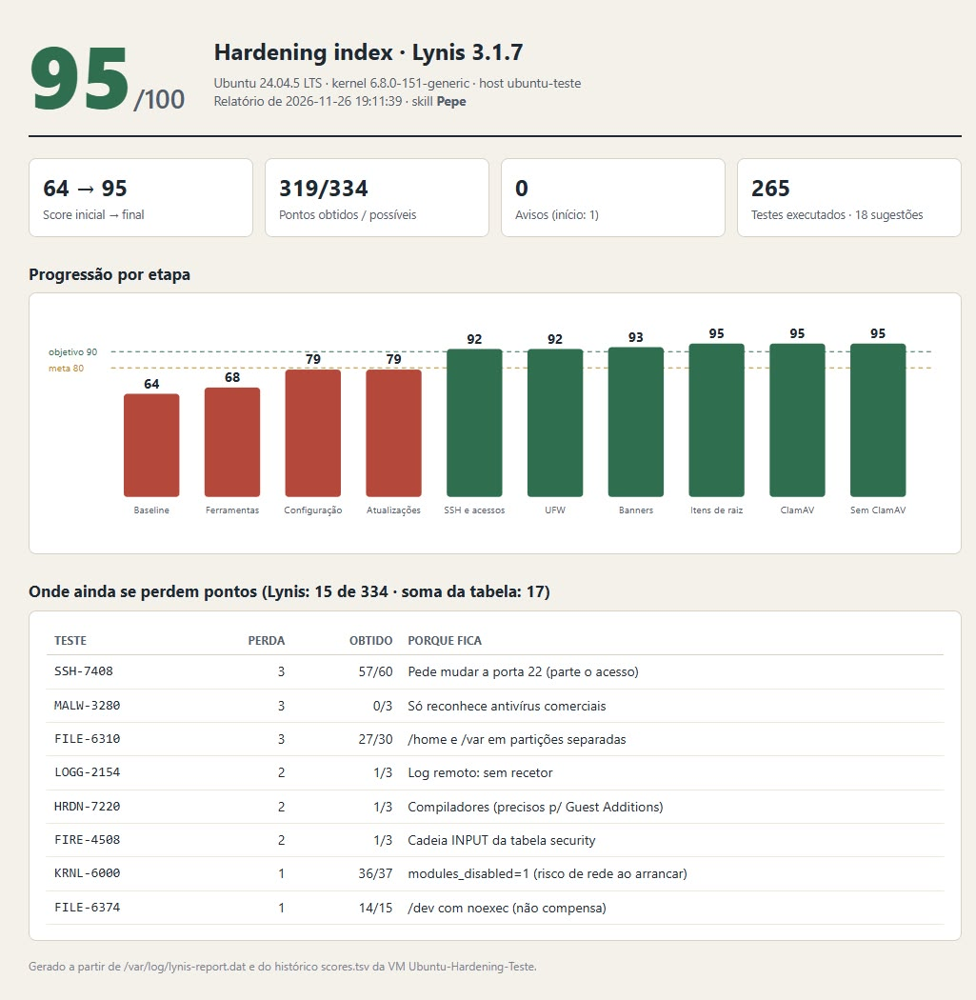
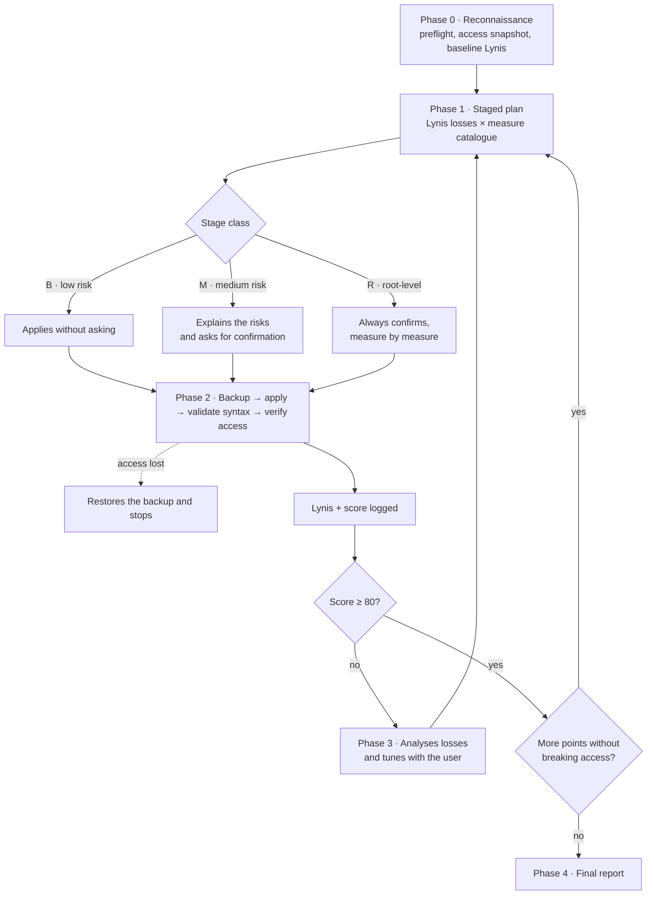

<p align="center">
  
</p>

<h1 align="center">Pepe: Lynis Hardening Skill for Claude Code</h1>

<p align="center">
  <strong>Measured, reversible hardening of Ubuntu and Debian servers, guided by the Lynis hardening index.</strong><br>
  A Claude Code skill that raises your Lynis score without breaking SSH, VPN, firewall or running services.
</p>

<p align="center">
  
  
  
  
  
</p>

<p align="center">
  🇬🇧 <b>English (UK)</b> · <a href="README.md">🇵🇹 Português</a>
</p>

<p align="center">
  <a href="#results">Results</a> ·
  <a href="#installation">Installation</a> ·
  <a href="#usage">Usage</a> ·
  <a href="#how-it-works">How it works</a> ·
  <a href="#scripts">Scripts</a> ·
  <a href="#limitations">Limitations</a> ·
  <a href="#faq">FAQ</a>
</p>

**Keywords:** Lynis hardening skill · Claude Code skill · Ubuntu server hardening · Debian server
hardening · Lynis hardening index · raise Lynis score · Linux security audit · SSH hardening ·
sysctl hardening · UFW · fail2ban · AI-assisted server hardening

---

## Summary

Generic hardening scripts, run blindly on a production server, undo configuration that was already
tuned: they cut the VPN with `ip_forward=0`, break Java applications with `/tmp` mounted `noexec`,
and change the SSH port without telling anyone. **Pepe** does the opposite. It uses the advanced
script as a **catalogue of measures**, not as an installer, and adapts each measure to the real
system:

1. **Measures** the starting state with the latest version of [Lynis](https://cisofy.com/lynis/).
2. **Inventories** the access that must not be lost (SSH sessions, VPN, firewall, ports, services).
3. **Plans** in stages, with every measure classified by risk.
4. **Applies** each change with a backup, validates the syntax and checks access after every step.
5. **Measures again** and repeats until the score reaches **80**, with a plan for **90**.
6. **Delivers** a visual report showing the progression and the reason for every point left out.

| | Typical approach | Pepe |
|---|---|---|
| Application | Full script, all at once | Stage by stage, measured between stages |
| Access | Checked afterwards (if you still have access) | Snapshot before; comparison after every change |
| Decisions | The script decides everything | **Low** risk automatic, **medium** and **root-level** confirmed |
| Rollback | Manual | `backup.sh --restore` per stage, including files newly created |
| Result | "It ran without errors" | Score before → after, losses per test and why |

## Results

| Target | Context | Lynis | Score | Access lost |
|---|---|---|---|---|
| Ubuntu 26.04 LTS server | Network sensor (Suricata, Zeek, Arkime), WireGuard VPN, UFW with rate limiting, fail2ban | 3.1.6 | **76 → 92** (343/372 points, 0 warnings) | 0 |
| Ubuntu 24.04.5 LTS VM | Test server in VirtualBox | 3.1.7 | **64 → 95** (319/334 points, 0 warnings) | 0 |

Final report generated by the skill on the test VM:

<p align="center">
  
</p>

On a server with a VPN and traffic capture, the practical ceiling is around **92–93**. The points
left out are deliberate and documented in [`catalogo-medidas.md`](pepe/references/catalogo-medidas.md)
(see [Limitations](#limitations)).

## Features

- **Score measured at every stage.** A clean Lynis run before and after, with the delta and per-test losses, saved to `scores.tsv`. An incomplete measurement is rejected, never logged.
- **Protected access.** Snapshot of services, ports (local or public reach), effective SSH configuration (`sshd -T`), firewall, WireGuard and network `sysctl`, compared after every change.
- **Detection of new attack surface.** A public port that did not exist before (for example, a mail server pulled in by a package) is flagged even when nothing was lost.
- **Three risk classes.** Low: applied without asking. Medium: risks explained and confirmed. Root-level: always confirmed, one by one.
- **Backup and rollback per stage**, including removal of anything the stage newly created.
- **Lynis always up to date**, installed from CISOfy's official repository (GitHub as fallback). The distribution package lags behind, and the score changes between versions.
- **Self-contained visual report** in HTML (no external dependencies): initial → final score, per-stage chart and losses with reasons.
- **Catalogue of 46 measures** (18 low risk, 16 medium, 12 root-level), each with the Lynis test it raises, what to check beforehand and how to undo it.
- **Lessons from real servers**: two Lynis runs at once, UFW overwriting `sysctl`, SSH drop-ins, banners that only score in English, `NOPASSWD`, and more.
- **No secrets.** The skill stores no credentials and only asks for the `sudo` password if `sudo -n true` fails.

## Requirements

| Side | Requirement |
|---|---|
| Working machine | [Claude Code](https://www.anthropic.com/claude-code) |
| Target | Ubuntu or Debian with `apt`, `sudo` and Python 3 (included by default on Ubuntu) |
| Network (target) | Access to `packages.cisofy.com` or `github.com` to install the latest Lynis |
| Connection | Local, or over SSH with the access you already use (key or `~/.ssh/config`) |

## Installation

The skill is the [`pepe/`](pepe) folder. Install it by copying it to `~/.claude/skills/pepe/`.

**Linux / macOS / WSL**

```bash
git clone --depth 1 https://github.com/DrNOFX97/pepe.git /tmp/pepe-repo
mkdir -p ~/.claude/skills
rm -rf ~/.claude/skills/pepe
cp -r /tmp/pepe-repo/pepe ~/.claude/skills/pepe
```

**Windows (PowerShell)**

```powershell
git clone --depth 1 https://github.com/DrNOFX97/pepe.git "$env:TEMP\pepe-repo"
New-Item -ItemType Directory -Force "$env:USERPROFILE\.claude\skills" | Out-Null
Remove-Item "$env:USERPROFILE\.claude\skills\pepe" -Recurse -Force -ErrorAction SilentlyContinue
Copy-Item "$env:TEMP\pepe-repo\pepe" "$env:USERPROFILE\.claude\skills\pepe" -Recurse
```

**Without git:** download `pepe.zip` from the [latest release](https://github.com/DrNOFX97/pepe/releases/latest) (it contains the `pepe/` folder) and unzip it into `~/.claude/skills/`.

**Verify:** start a **new** Claude Code session (skills are read at startup) and type `/pepe`.
**Update:** repeat the same commands; the old folder is replaced.

> [!TIP]
> The [`.gitattributes`](.gitattributes) file forces LF line endings on `.sh`, `.py` and `.md`
> files. On Windows this prevents the `bad interpreter: /bin/bash^M` error when the scripts are
> copied to the server.

## Usage

Ask in natural language or invoke the skill directly:

```text
harden this server
raise the Lynis score on server X without touching the VPN
/pepe
```

Pepe always starts with **Phase 0, read-only**: it shows the access it will protect and the
starting score before changing anything. After each completed stage it reports one line, for example:

```text
Stage 3 | kernel and network sysctl (B) | 81 → 85 (+4) | access OK
```

At the end it delivers the HTML report, a screenshot of it and a summary: what was applied, what was
refused and why, what is impossible without breaking access, what is pending (reboots) and the
rollback command for each stage.

## How it works



### Risk classes

| Class | Who decides | Examples |
|---|---|---|
| **L** · low (*B* in the skill files) | Pepe applies it, with backup and verification | missing audit tools, legacy filesystems disabled, core dumps, safe `sysctl` values, banners |
| **M** · medium | The user confirms, with the risks explained | `apt upgrade`, fail2ban, UFW, SSH options, `hidepid`, USBGuard |
| **R** · root-level | The user always confirms, one by one | SSH port/authentication, GRUB, `ip_forward`, package removal, `/tmp` `noexec`, PAM, `sudoers` |

When in doubt, a measure moves up a class. Context can also move it down: on a VM without USB
devices, USB measures become low risk, because there is no keyboard or mouse that could be locked out.

### Safety guarantees

- No change before the access snapshot and the baseline measurement.
- Backup before every stage; new files (`/etc/sysctl.d/99-zz-*.conf`, drop-ins) instead of editing existing ones.
- Syntax validation before reloading services (`sshd -t`, `rsyslogd -N1`, `aide --config-check`, …).
- For changes to SSH, PAM, passwords or the firewall, a **new login** is tested while the old session is still open.
- Packages installed with `--no-install-recommends`, so no extra services are dragged in.
- Before promising points, Pepe checks in the Lynis test code what the test actually looks for.

## Scripts

The scripts in [`pepe/scripts/`](pepe/scripts) also work without Claude. Copy them to a user folder
on the target (not `/tmp`) and run them with `sudo`.

| Script | Purpose | Example |
|---|---|---|
| `preflight.sh` | Read-only inventory: active SSH sessions (on the real `sshd` port), effective access, firewall, VPN, services, missing packages, updates, USB, mounts | `sudo ./preflight.sh` |
| `verificar_acessos.sh` | Saves and compares the state of access paths | `sudo ./verificar_acessos.sh --snapshot` |
| `instalar_lynis.sh` | Installs or upgrades Lynis to the latest version | `sudo ./instalar_lynis.sh` |
| `lynis_medir.sh` | Runs Lynis in isolation, logs the score and shows delta and losses | `sudo ./lynis_medir.sh baseline` |
| `lynis_perdas.sh` | Per-test loss table from the last Lynis run | `sudo ./lynis_perdas.sh` |
| `backup.sh` | Backs up and restores configuration; aborts if the backup fails | `sudo ./backup.sh e2-sysctl /etc/sysctl.d` |
| `gerar_relatorio.py` | Self-contained HTML final report | `sudo python3 ./gerar_relatorio.py` |

**Exit codes of `verificar_acessos.sh`**

| Code | Meaning | Action |
|---|---|---|
| `0` | Nothing lost, nothing newly opened | Continue |
| `1` | An access path disappeared or changed | Restore the backup and stop |
| `2` | Nothing lost, but new public ports appeared | Close or remove the new service |
| `3` | No snapshot exists | Run `--snapshot` first |

Logs are kept in `/root/hardening-log/` (configurable with `HLOG_DIR`): `scores.tsv`,
`acessos.snapshot`, `report-<label>.dat`, `backups/` and `relatorio.html`. Optionally, a `urls.conf`
file with `URL HTTP_CODE` lines adds HTTP checks to the snapshot.

## Limitations

Pepe does not chase a perfect 100. These items are left without points on purpose, unless the user
explicitly decides otherwise:

| Lynis test | Measure | Why it is left out |
|---|---|---|
| DEB-0510 | Disk encryption (LUKS) | Only possible with a reinstall |
| FILE-6310 | `/home` and `/var` on separate partitions | Only possible with a reinstall |
| KRNL-6000 | `ip_forward=0`, `rp_filter=1` | They break the VPN and routing |
| FILE-6374 | `/tmp` on `noexec` | Breaks Java/OpenSearch and installers |
| HRDN-7220 | Remove compilers | Can take the desktop environment or tools in use with it |
| MALW-3280 | Antivirus | The test only recognises commercial products |
| LOGG-2154 | Remote logging | Needs a log receiver |

Other limitations:

- Only supports distributions with `apt` (Ubuntu, Debian and derivatives).
- There is no automated test suite; the scripts were validated by hand on the targets above
  (inventory, detection of deliberate changes, backup/restore including new files, and a full
  Lynis measurement).
- The Lynis score is an indicator, not a certification: it does not replace an audit or a CIS benchmark.

## Repository structure

```text
.
├── README.md / README.en-GB.md
├── LICENSE
├── docs/capa.webp                cover image
├── evidencias/                   final report screenshot (Ubuntu 24.04 VM)
└── pepe/                         the skill: the folder you install
    ├── SKILL.md                  workflow, principles and confirmation rules
    ├── scripts/                  preflight, access check, Lynis, backup, report
    ├── references/
    │   ├── catalogo-medidas.md   46 measures by class, with Lynis test and rollback
    │   ├── licoes.md             pitfalls found on real servers
    │   └── relatorio.md          how to generate the final report and its screenshot
    └── assets/
        └── hardening_ubuntu.sh   advanced script v3.1, used as a list of measures
```

The skill's own files are written in Portuguese; Claude reads them and answers in the language you write in.

## Roadmap

- [x] Phased workflow with risk classes and confirmations
- [x] Inventory, access verification, measurement, losses and backup
- [x] Visual HTML report
- [x] End-to-end validation on a real server and a VM
- [ ] Automated tests for the scripts (e.g. `bats` in an Ubuntu container)
- [ ] Support for `dnf` distributions (RHEL, Rocky, Fedora)

## Contributing

1. Fork the repository and create a branch (`git checkout -b improvement/short-description`).
2. Test script changes on a VM you can roll back (VirtualBox snapshot or similar), including
   `bash -n` and, ideally, `shellcheck`.
3. If you find a new pitfall, document it in `pepe/references/licoes.md`.
4. Open a pull request with the score before → after and the target you tested on.

## Disclaimer

This tool changes the security configuration of a system. Only use it on machines you administer
or are authorised to change, and test it on a copy or VM first. Despite the access checks and
backups, responsibility for the changes applied lies with whoever approves them.

## About the name

A nod to the footballer Pepe, famous for being hard to get past: the skill makes the server tough
without taking away its mobility, that is, without breaking the access of the people who use it.

## Licence

Distributed under the [MIT licence](LICENSE), including `pepe/assets/hardening_ubuntu.sh`.
