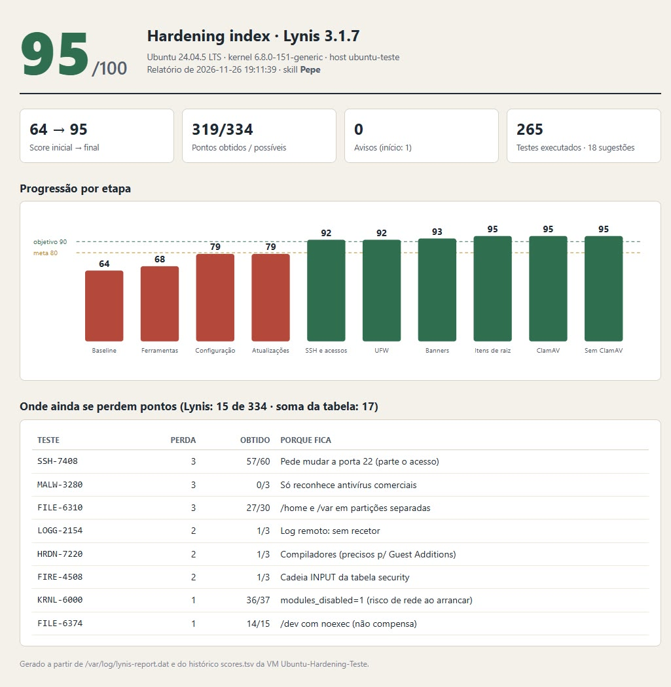
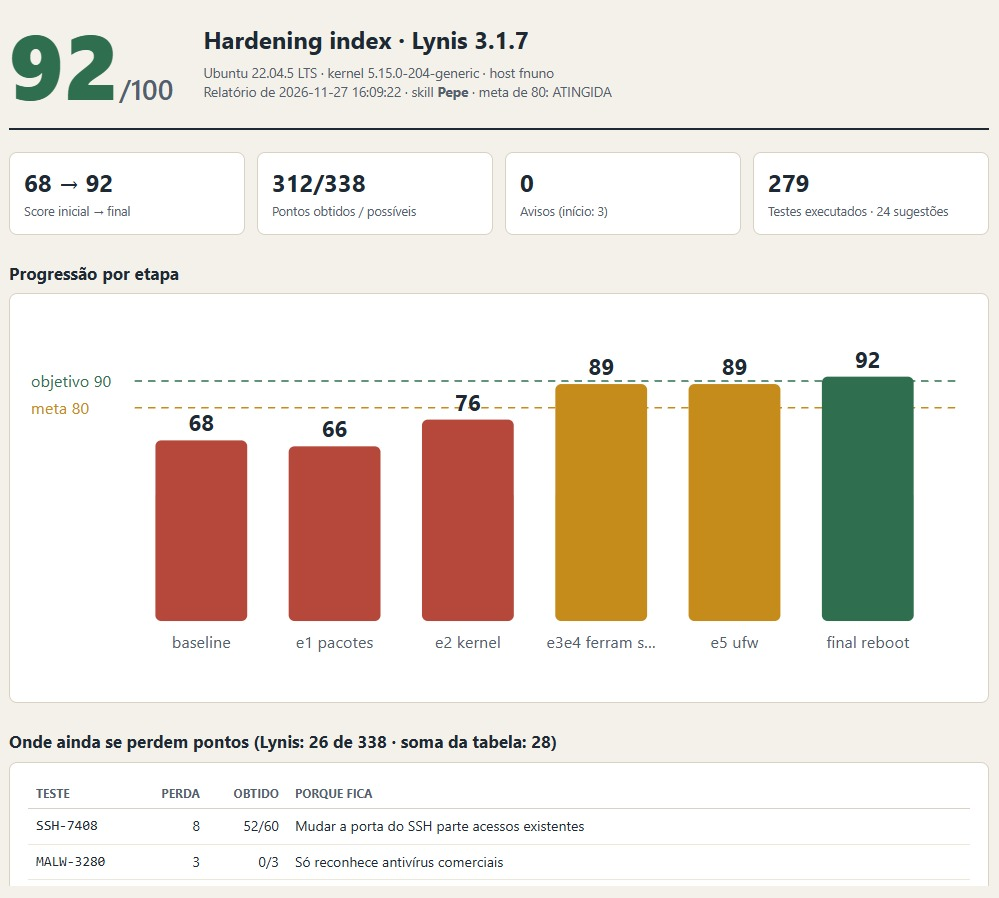
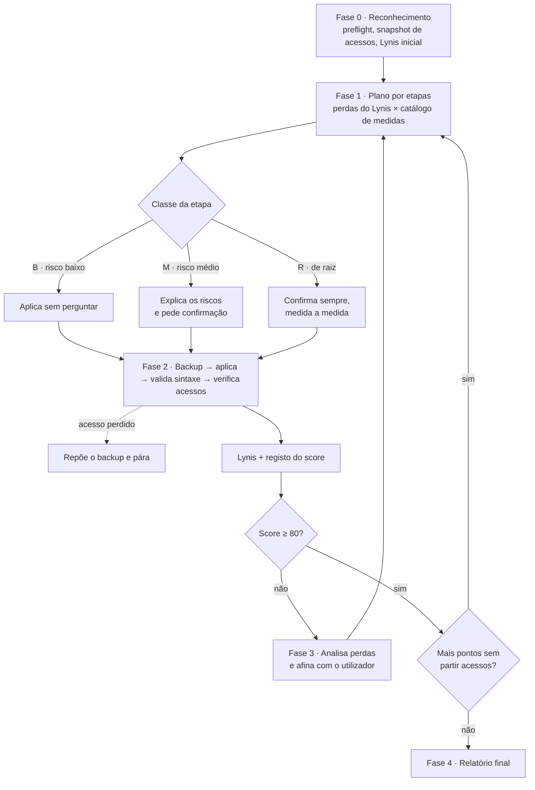

<p align="center">
  
</p>

<h1 align="center">Pepe</h1>

<p align="center">
  <strong>Hardening medido e reversível de servidores Ubuntu/Debian, guiado pelo score do Lynis.</strong><br>
  Uma skill para agentes de código (Claude Code, OpenCode, Codex, Gemini CLI…) que sobe o <em>hardening index</em> sem partir SSH, VPN, firewall nem serviços.
</p>

<p align="center">
  
  
  
  
  
</p>

<p align="center">
  <a href="#resultados">Resultados</a> ·
  <a href="#instalação">Instalação</a> ·
  <a href="#utilização">Utilização</a> ·
  <a href="#como-funciona">Como funciona</a> ·
  <a href="#scripts">Scripts</a> ·
  <a href="#limitações">Limitações</a>
</p>

<p align="center">
  🇵🇹 <b>Português</b> · <a href="README.en-GB.md">🇬🇧 English (UK)</a>
</p>

---

## Resumo

Os scripts de hardening genéricos, corridos às cegas num servidor em produção, desfazem
configuração que já estava afinada: cortam a VPN com `ip_forward=0`, partem aplicações Java com
`/tmp` em `noexec`, mudam a porta do SSH sem avisar ninguém. O **Pepe** faz o contrário. Usa o
script avançado como **catálogo de medidas**, não como instalador, e adapta cada medida ao
sistema real:

1. **Mede** o estado inicial com a versão mais recente do [Lynis](https://cisofy.com/lynis/).
2. **Inventaria** os acessos que não se podem perder (sessões SSH, VPN, firewall, portas, serviços).
3. **Planeia** por etapas, cada medida classificada por risco.
4. **Aplica** com backup, valida a sintaxe e verifica os acessos depois de cada passo.
5. **Volta a medir** e repete até ao score **80**, com plano para os **90**.
6. **Entrega** um relatório visual com a progressão e o motivo de cada ponto que ficou de fora.

| | Abordagem típica | Pepe |
|---|---|---|
| Aplicação | Script completo, de uma vez | Etapa a etapa, com medição entre etapas |
| Acessos | Verificados depois (se houver acesso) | Snapshot antes; comparação após cada alteração |
| Decisão | O script decide tudo | Risco **baixo** automático, **médio** e **de raiz** confirmados |
| Reversão | Manual | `backup.sh --restore` por etapa, incluindo ficheiros criados de novo |
| Resultado | "Correu sem erros" | Score antes → depois, perdas por teste e motivo |

## Resultados

| Alvo | Contexto | Lynis | Score | Acessos perdidos |
|---|---|---|---|---|
| Servidor Ubuntu 26.04 LTS | Sensor de rede (Suricata, Zeek, Arkime), VPN WireGuard, UFW com rate-limit, fail2ban | 3.1.6 | **76 → 92** (343/372 pontos, 0 avisos) | 0 |
| VM Ubuntu 24.04.5 LTS | Servidor de teste em VirtualBox | 3.1.7 | **64 → 95** (319/334 pontos, 0 avisos) | 0 |
| VM Wazuh-Manager (Ubuntu 22.04.5 LTS) | Manager do Wazuh no laboratório de deteção | 3.1.7 | **68 → 92** (312/338 pontos, 0 avisos) | — |

Relatório final gerado pela skill na VM de teste (Ubuntu 24.04):

<p align="center">
  
</p>

E na VM Wazuh-Manager (Ubuntu 22.04):

<p align="center">
  
</p>

Num servidor com VPN e captura de tráfego, o teto prático ronda os **92–93**. Os pontos que
ficam de fora são deixados de propósito e estão documentados em
[`catalogo-medidas.md`](pepe/references/catalogo-medidas.md) (ver [Limitações](#limitações)).

## Funcionalidades

- **Score medido a cada etapa.** Lynis limpo antes e depois, com variação e perdas por teste, gravado em `scores.tsv`. Uma medição incompleta é rejeitada, nunca registada.
- **Acessos protegidos.** Snapshot de serviços, portas (com alcance local/público), SSH efetivo (`sshd -T`), firewall, WireGuard e `sysctl` de rede, comparado depois de cada alteração.
- **Deteção de nova superfície de ataque.** Uma porta pública que não existia (por exemplo, um MTA arrastado por um pacote) é sinalizada mesmo que nada se tenha perdido.
- **Três classes de risco.** Baixo: aplicado sem perguntar. Médio: riscos explicados e confirmação. De raiz: confirmação sempre, uma a uma.
- **Backup e rollback por etapa**, incluindo a remoção do que a etapa criou de novo.
- **Lynis sempre atualizado** a partir do repositório oficial da CISOfy (GitHub como alternativa). O pacote da distribuição fica para trás e o score muda entre versões.
- **Relatório visual autónomo** em HTML (sem dependências externas): score inicial → final, gráfico por etapa e perdas com o motivo.
- **Catálogo de 46 medidas** (18 de risco baixo, 16 médio, 12 de raiz), cada uma com o teste do Lynis que sobe, o que verificar antes e como desfazer.
- **Lições de servidores reais**: dois Lynis em simultâneo, UFW a repor `sysctl`, drop-ins do SSH, banners que só pontuam em inglês, `NOPASSWD`, entre outras.
- **Sem segredos.** A skill não guarda credenciais e só pede a password do `sudo` se `sudo -n true` falhar.

## Requisitos

| Lado | Requisito |
|---|---|
| Máquina de trabalho | Um agente de código que leia skills: Claude Code, OpenCode, Codex, Gemini CLI ou outro. Testado com Claude Code (Sonnet 5.5) e OpenCode (DeepSeek V4.1 Flash) |
| Alvo | Ubuntu ou Debian com `apt`, `sudo` e Python 3 (incluído por defeito no Ubuntu) |
| Rede (alvo) | Acesso a `packages.cisofy.com` ou `github.com` para instalar o Lynis mais recente |
| Ligação | Local, ou por SSH com o acesso que já usas (chave ou `~/.ssh/config`) |

## Instalação

A skill é a pasta [`pepe/`](pepe). Instala-se copiando-a para a pasta de skills da ferramenta que usas.
Os comandos abaixo são para o Claude Code (`~/.claude/skills/pepe/`).

**Linux / macOS / WSL**

```bash
git clone --depth 1 https://github.com/DrNOFX97/pepe.git /tmp/pepe-repo
mkdir -p ~/.claude/skills
rm -rf ~/.claude/skills/pepe
cp -r /tmp/pepe-repo/pepe ~/.claude/skills/pepe
```

**Windows (PowerShell)**

```powershell
git clone --depth 1 https://github.com/DrNOFX97/pepe.git "$env:TEMP\pepe-repo"
New-Item -ItemType Directory -Force "$env:USERPROFILE\.claude\skills" | Out-Null
Remove-Item "$env:USERPROFILE\.claude\skills\pepe" -Recurse -Force -ErrorAction SilentlyContinue
Copy-Item "$env:TEMP\pepe-repo\pepe" "$env:USERPROFILE\.claude\skills\pepe" -Recurse
```

**Sem git:** descarrega o `pepe.zip` da [última release](https://github.com/DrNOFX97/pepe/releases/latest) (contém a pasta `pepe/`) e descomprime-o em `~/.claude/skills/`.

**Outras ferramentas:** copia a pasta `pepe/` para a pasta de skills da ferramenta (por exemplo
`~/.opencode/skills/`). O OpenCode também lê as skills de `~/.claude/skills/`: se já a instalaste
para o Claude Code, não precisas de a duplicar.

**Verificar:** abre uma sessão **nova** do teu agente (as skills são lidas no arranque) e escreve
`/pepe` ou pede o hardening em linguagem natural. **Atualizar:** repete os mesmos comandos; a pasta antiga é substituída.

> [!TIP]
> O [`.gitattributes`](.gitattributes) força quebras de linha LF nos `.sh`, `.py` e `.md`. No
> Windows isto evita o erro `bad interpreter: /bin/bash^M` quando os scripts são copiados para o
> servidor.

## Utilização

Pede em linguagem natural ou invoca a skill diretamente:

```text
faz o hardening deste servidor
sobe o score do Lynis no servidor X sem mexer na VPN
/pepe
```

O Pepe começa sempre pela **Fase 0, só de leitura**: mostra os acessos que vai proteger e o score
inicial antes de alterar seja o que for. Por cada etapa concluída, reporta uma linha (exemplo):

```text
Etapa 3 | sysctl de kernel e rede (B) | 81 → 85 (+4) | acessos OK
```

No fim entrega o relatório HTML, um print dele e o resumo: o que foi aplicado, o que foi recusado
e porquê, o que é impossível sem partir acessos, pendentes (reinícios, reboot) e o comando de
rollback de cada etapa.

## Como funciona



### Classes de risco

| Classe | Quem decide | Exemplos |
|---|---|---|
| **B** · baixo | O Pepe aplica, com backup e verificação | ferramentas de auditoria em falta, filesystems legados desativados, core dumps, `sysctl` seguros, banners |
| **M** · médio | O utilizador confirma, com os riscos explicados | `apt upgrade`, fail2ban, UFW, opções do SSH, `hidepid`, USBGuard |
| **R** · de raiz | O utilizador confirma sempre, uma a uma | porta/autenticação do SSH, GRUB, `ip_forward`, remover pacotes, `/tmp` `noexec`, PAM, `sudoers` |

Na dúvida, a medida sobe de classe. O contexto também pode baixá-la: numa VM sem dispositivos USB,
as medidas de USB passam a B, porque não há teclado nem rato que se possa bloquear.

### Garantias de segurança

- Nenhuma alteração antes do snapshot de acessos e da medição inicial.
- Backup antes de cada etapa; ficheiros novos (`/etc/sysctl.d/99-zz-*.conf`, drop-ins) em vez de edição dos existentes.
- Validação de sintaxe antes de recarregar serviços (`sshd -t`, `rsyslogd -N1`, `aide --config-check`, …).
- Em alterações a SSH, PAM, passwords ou firewall, um **login novo** é testado com a sessão antiga ainda aberta.
- Pacotes instalados com `--no-install-recommends`, para não arrastar serviços.
- Antes de prometer pontos, o Pepe confirma no código do teste do Lynis o que ele procura de facto.

## Scripts

Os scripts em [`pepe/scripts/`](pepe/scripts) também se podem correr à mão, sem agente. Copia-os
para uma pasta do utilizador no alvo (não para `/tmp`) e corre-os com `sudo`.

> [!WARNING]
> Usados à mão, os scripts são da tua inteira responsabilidade. Fora do fluxo da skill não há
> plano, classes de risco nem confirmações, e não há garantia de que funcionem nem de que não
> estraguem algo.

| Script | Função | Exemplo |
|---|---|---|
| `preflight.sh` | Inventário só de leitura: sessões SSH ativas (na porta real do `sshd`), acesso efetivo, firewall, VPN, serviços, pacotes em falta, atualizações, USB, montagens | `sudo ./preflight.sh` |
| `verificar_acessos.sh` | Grava e compara o estado dos acessos | `sudo ./verificar_acessos.sh --snapshot` |
| `instalar_lynis.sh` | Instala ou atualiza o Lynis para a versão mais recente | `sudo ./instalar_lynis.sh` |
| `lynis_medir.sh` | Corre o Lynis isolado, regista o score e mostra variação e perdas | `sudo ./lynis_medir.sh baseline` |
| `lynis_perdas.sh` | Tabela de perdas por teste do último Lynis | `sudo ./lynis_perdas.sh` |
| `backup.sh` | Backup e restauro de configuração; aborta se o backup falhar | `sudo ./backup.sh e2-sysctl /etc/sysctl.d` |
| `gerar_relatorio.py` | Relatório final em HTML autónomo | `sudo python3 ./gerar_relatorio.py` |
| `hardening_ubuntu.sh` | Script de hardening avançado (v3.1) em 27 passos; é dele que a skill tira as medidas | `sudo ./hardening_ubuntu.sh` |

**`hardening_ubuntu.sh`**

É a base das medidas do Pepe. Na skill, o agente lê-o, vê que medidas já estão aplicadas no alvo e
adapta as restantes ao sistema real, em vez de o correr de uma vez. Corrido sozinho, faz 27 passos:
deteção do ambiente (container, Docker, nome do serviço SSH), atualização do sistema, pacotes de
segurança (fail2ban, auditd, AIDE, rkhunter, chkrootkit, UFW, AppArmor, Lynis…), PAM e políticas de
password, UFW com rate-limit no SSH, `sysctl` de kernel e rede, módulos de kernel, SSH com cifras
modernas, banners, timeout e umask, regras do auditd, jail do fail2ban, `cron`/`at`, permissões de
ficheiros sensíveis, AppArmor em enforce, journald, `acct`, Ctrl+Alt+Del, AIDE e rkhunter com
verificação diária, unattended-upgrades e uma auditoria final com o Lynis.

As medidas mais agressivas estão atrás de variáveis no topo do script:

| Variável | Defeito | O que faz |
|---|---|---|
| `DISABLE_SSH_PASSWORD_AUTH` | `false` | SSH só por chave |
| `ENABLE_GRUB_HARDENING` | `false` | Parâmetros de kernel no GRUB (requer reboot) |
| `SET_GRUB_PASSWORD` | `false` | Password no bootloader (interativa) |
| `RESTRICT_COMPILERS` | `false` | `gcc`/`cc` só para root |
| `DISABLE_UNCOMMON_FILESYSTEMS` | `true` | Desativa cramfs, freevxfs, jffs2, hfs, hfsplus e udf |
| `HARDEN_TMP_MOUNTS` | `false` | `nodev,nosuid,noexec` em `/tmp`, `/var/tmp` e `/dev/shm` |
| `DISABLE_UNUSED_SERVICES` | `false` | Desativa cups, avahi, rpcbind e nfs-server se estiverem ativos |
| `FORWARD_JOURNAL_TO_SYSLOG` | `true` | Mantém o reenvio do journald para o syslog |

Com Docker detetado, mantém `ip_forward` ativo; em containers salta os passos de GRUB e kernel.

**Códigos de saída do `verificar_acessos.sh`**

| Código | Significado | Ação |
|---|---|---|
| `0` | Nada se perdeu nem se abriu | Continuar |
| `1` | Um acesso desapareceu ou mudou | Repor o backup e parar |
| `2` | Nada se perdeu, mas há portas públicas novas | Fechar ou remover o serviço novo |
| `3` | Não existe snapshot | Correr `--snapshot` primeiro |

Os registos ficam em `/root/hardening-log/` (configurável com `HLOG_DIR`): `scores.tsv`,
`acessos.snapshot`, `report-<etiqueta>.dat`, `backups/` e `relatorio.html`. Opcionalmente,
`urls.conf` com linhas `URL CÓDIGO_HTTP` acrescenta verificações HTTP ao snapshot.

## Limitações

O Pepe não persegue os 100. Estes itens ficam sem pontos de propósito, salvo decisão explícita
do utilizador:

| Teste Lynis | Medida | Porque fica de fora |
|---|---|---|
| DEB-0510 | Cifra de disco (LUKS) | Só com reinstalação |
| FILE-6310 | `/home`, `/var` em partições separadas | Só com reinstalação |
| KRNL-6000 | `ip_forward=0`, `rp_filter=1` | Partem a VPN e o encaminhamento |
| FILE-6374 | `/tmp` em `noexec` | Parte Java/OpenSearch e instaladores |
| HRDN-7220 | Remover compiladores | Pode levar consigo o ambiente gráfico ou ferramentas em uso |
| MALW-3280 | Antivírus | O teste só reconhece produtos comerciais |
| LOGG-2154 | Log remoto | Precisa de um recetor de logs |

Outras limitações:

- Suporta apenas distribuições com `apt` (Ubuntu, Debian e derivadas).
- Não há suite de testes automatizados; os scripts foram validados manualmente nos alvos acima
  (inventário, deteção de alterações propositadas, backup/restauro incluindo ficheiros novos e
  medição completa do Lynis).
- O score do Lynis é um indicador, não uma certificação: não substitui uma auditoria nem um
  benchmark CIS.

## Estrutura do repositório

```text
.
├── README.md
├── LICENSE
├── docs/capa.webp                imagem de capa
├── evidencias/                   prints dos relatórios finais (VM Ubuntu 24.04 e Wazuh-Manager)
└── pepe/                         a skill: a pasta que se instala
    ├── SKILL.md                  fluxo, princípios e regras de confirmação
    ├── scripts/                  preflight, verificação de acessos, Lynis, backup, relatório
    │                             e hardening_ubuntu.sh (script avançado v3.1)
    └── references/
        ├── catalogo-medidas.md   46 medidas por classe, com teste Lynis e rollback
        ├── licoes.md             armadilhas encontradas em servidores reais
        └── relatorio.md          como gerar o relatório final e o print
```

## Roadmap

- [x] Fluxo por fases com classes de risco e confirmações
- [x] Inventário, verificação de acessos, medição, perdas e backup
- [x] Relatório visual em HTML
- [x] Validação ponta a ponta num servidor real e numa VM
- [ ] Testes automatizados dos scripts (ex.: `bats` num contentor Ubuntu)
- [ ] Suporte a distribuições com `dnf` (RHEL, Rocky, Fedora)

## Contribuir

1. Faz fork e cria um ramo (`git checkout -b melhoria/descricao`).
2. Testa as alterações aos scripts numa VM que possas reverter (snapshot do VirtualBox ou similar),
   incluindo `bash -n` e, de preferência, `shellcheck`.
3. Se descobrires uma armadilha nova, documenta-a em `pepe/references/licoes.md`.
4. Abre um pull request com o score antes → depois e o alvo onde testaste.

## Aviso

Esta ferramenta altera a configuração de segurança do sistema. Usa-a apenas em máquinas que
administras ou para as quais tens autorização, e testa primeiro numa cópia ou VM. Apesar das
verificações de acesso e dos backups, a responsabilidade pelas alterações aplicadas é de quem as
aprova. Os scripts corridos à mão, fora da skill, são usados por conta e risco de quem os corre.

## Sobre o nome

Homenagem ao futebolista Pepe, pela dureza: a skill torna o servidor duro sem lhe tirar a
mobilidade, isto é, sem partir os acessos de quem o usa.

## Licença

Distribuído sob a licença [MIT](LICENSE).
