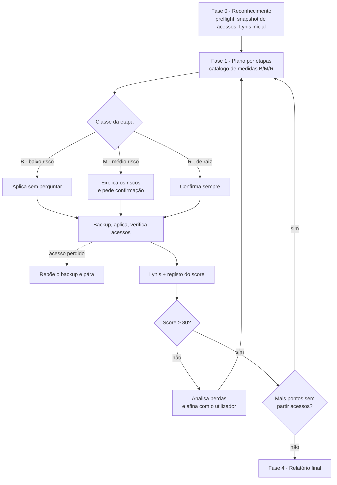

# Pepe

**Skill do Claude Code que endurece servidores Ubuntu/Debian guiada pelo score do Lynis, sem partir SSH, VPN, firewall nem serviços.**

<p align="center">
  
  
  
  
  
</p>

## Overview

O Pepe conduz o hardening de um servidor Ubuntu do início ao fim: mede o estado inicial com o
[Lynis](https://cisofy.com/lynis/), inventaria o que está instalado e falta, planeia as alterações
por etapas, aplica-as com backup e verifica a cada passo que nenhum acesso privado se perdeu.
Regista o score antes e depois de cada etapa e só pára quando o servidor chega aos **80** (com
plano para os **90**) ou quando fica demonstrado, por escrito, o que o impede.

Destina-se a quem administra servidores reais (com VPN, captura de tráfego, serviços internos) e
não pode correr um script de hardening genérico às cegas: esses scripts, aplicados sem adaptação,
desfazem configuração que já estava afinada. O Pepe usa o script avançado como **lista de
medidas**, não como instalador, e adapta cada uma ao sistema.

> **Porquê "Pepe"?** O nome é uma homenagem ao futebolista Pepe, pela dureza: a skill torna o
> servidor duro, sem lhe tirar a mobilidade, isto é, sem partir os acessos de quem o usa.

## Features

- **Score medido a cada etapa:** Lynis limpo antes e depois, com variação e perdas por teste, gravado em `scores.tsv`.
- **Acessos protegidos:** snapshot de serviços, portas, SSH efetivo, firewall, VPN e `sysctl` de rede; comparado após cada alteração.
- **Três classes de risco:** baixo aplica sozinho, médio pede confirmação, "de raiz" pede sempre.
- **Backup e rollback por etapa**, incluindo apagar o que a etapa criou de novo.
- **Relatório visual no fim:** página HTML com o score inicial → final, o gráfico por etapa e as perdas com o motivo, mais um print dela (ver `evidencias/lynis-report-vm-teste.png`).
- **Loop até aos 80** e plano até aos 90; abaixo de 80 analisa as perdas e afina com o utilizador.
- **Sem segredos:** não guarda credenciais; só pede a password do `sudo` quando `sudo -n true` falha.
- **Catálogo de 42 medidas** classificadas (15 baixo, 15 médio, 12 de raiz) e lições aprendidas em servidores reais.

## Como funciona



| Classe | Quem decide | Exemplos |
|---|---|---|
| **B** · baixo | Pepe aplica | filesystems legacy desativados, core dumps off, `sysctl` seguros, banners |
| **M** · médio | Utilizador confirma, com os riscos explicados | `apt upgrade`, fail2ban, UFW, SSH, `hidepid`, USBGuard |
| **R** · de raiz | Utilizador confirma sempre | porta/autenticação do SSH, GRUB, `ip_forward`, remover pacotes, `/tmp` `noexec` |

## Tech Stack

| Componente | Tecnologia |
|---|---|
| Instruções da skill | Markdown (`SKILL.md` + `references/`) |
| Ferramentas no alvo | Bash |
| Auditoria | Lynis, sempre a última versão (instalada pela skill) |
| Plataforma alvo | Ubuntu / Debian com `sudo` |
| Agente | Claude Code |

## Getting Started

### Pré-requisitos

- Claude Code instalado.
- Servidor Ubuntu/Debian com `sudo`, acessível a partir da sessão (local ou por SSH).
- O Lynis é instalado ou atualizado pela própria skill para a **versão mais recente** (repositório
  oficial da CISOfy, com o GitHub como alternativa), porque o do repositório do Ubuntu fica
  atrás (o 24.04 traz a 3.0.9) e o score muda entre versões.

### Instalação

Copia a pasta `pepe/` para a pasta de skills do Claude Code, ou descomprime `pepe.zip` lá:

- Windows: `%USERPROFILE%\.claude\skills\pepe\`
- Linux / macOS: `~/.claude/skills/pepe/`

Abre uma sessão nova do Claude Code para a skill ser carregada.

### Utilização

Diz ao Claude, por exemplo:

```text
faz o hardening deste servidor
sobe o Lynis do servidor X
/pepe
```

O Pepe começa sempre pela Fase 0 (só leitura) e mostra os acessos que vai proteger antes de
alterar seja o que for.

Os scripts também funcionam sozinhos no alvo (copiados para uma pasta do utilizador, com `sudo`):

| Script | Para quê | Exemplo |
|---|---|---|
| `preflight.sh` | Inventário só de leitura: sessões SSH, `sshd -T`, firewall, VPN, serviços, pacotes em falta | `sudo ./preflight.sh` |
| `verificar_acessos.sh` | Guarda e compara o estado dos acessos | `sudo ./verificar_acessos.sh --snapshot` · `sudo ./verificar_acessos.sh` |
| `instalar_lynis.sh` | Instala ou atualiza o Lynis para a versão mais recente | `sudo ./instalar_lynis.sh` |
| `lynis_medir.sh` | Corre o Lynis sozinho, regista e compara o score (falha em vez de registar uma medição incompleta) | `sudo ./lynis_medir.sh "baseline"` |
| `lynis_perdas.sh` | Tabela de perdas por teste do último Lynis | `sudo ./lynis_perdas.sh` |
| `gerar_relatorio.py` | Relatório final em HTML autónomo (corre no alvo; precisa de Python 3) | `sudo python3 ./gerar_relatorio.py` |
| `backup.sh` | Backup e restauro de ficheiros de configuração | `sudo ./backup.sh sysctl /etc/sysctl.d` · `sudo ./backup.sh --restore <pasta>` |

Os registos ficam em `/root/hardening-log/` (`scores.tsv`, `acessos.snapshot`, `backups/`).

## Resultados

Validado num servidor Ubuntu 26.04 LTS com sensor de rede (Suricata, Zeek, Arkime), VPN WireGuard,
UFW com rate-limit e fail2ban: o Lynis 3.1.6 passou de **76 para 92** (343 de 372 pontos, 0 avisos) sem
perder nenhum acesso; o `lynis_medir.sh` reproduziu os 92 na medição final.

Num servidor com VPN e captura, o teto prático ronda os **92–93**. O que fica sem pontos de
propósito está documentado em `references/catalogo-medidas.md`: cifra de disco (LUKS), partições
separadas, `ip_forward=0` e `rp_filter=1` (partem a VPN), `/tmp` `noexec` (parte Java/OpenSearch),
remover compiladores (levaria o ambiente gráfico).

## Testing

Não há suite de testes automatizados. Os scripts foram executados à mão no servidor acima (e o
`instalar_lynis.sh` numa VM Ubuntu 24.04, onde atualizou o Lynis 3.0.9 para a 3.1.7):
inventário, snapshot com deteção de uma alteração propositada, backup/restauro (incluindo ficheiro
criado de novo) e medição completa do Lynis.

## Project Structure

```text
pepe/
├── SKILL.md                    fluxo, princípios e regras de confirmação
├── scripts/
│   ├── preflight.sh
│   ├── verificar_acessos.sh
│   ├── instalar_lynis.sh
│   ├── lynis_medir.sh
│   ├── lynis_perdas.sh
│   ├── backup.sh
│   └── gerar_relatorio.py
├── references/
│   ├── catalogo-medidas.md     medidas por classe B/M/R, com teste Lynis e rollback
│   ├── relatorio.md            como gerar a página final e tirar-lhe o print
│   └── licoes.md               armadilhas reais (dois Lynis em simultâneo, UFW, NOPASSWD…)
└── assets/
    └── hardening_ubuntu.sh     script avançado v3.1 do material do curso (só como referência)
```

## Roadmap

### Planned

- Validação ponta a ponta numa VM Ubuntu 24.04 limpa (VirtualBox), partindo de um *snapshot*.
- Testes automatizados dos scripts.

### Completed

- Fluxo por fases com classes de risco e confirmações.
- Scripts de inventário, verificação de acessos, medição, perdas e backup.
- Catálogo de medidas e lições aprendidas.

## Contributing

```text
Fork
→ Cria um ramo
→ Altera (e testa os scripts num servidor que possas reverter)
→ Abre um pull request
```

## License

[MIT](LICENSE). Exceção: o `pepe/assets/hardening_ubuntu.sh` é material do curso e **não** está
abrangido por esta licença (ver `pepe/assets/NOTICE.txt`); está incluído só como referência.
